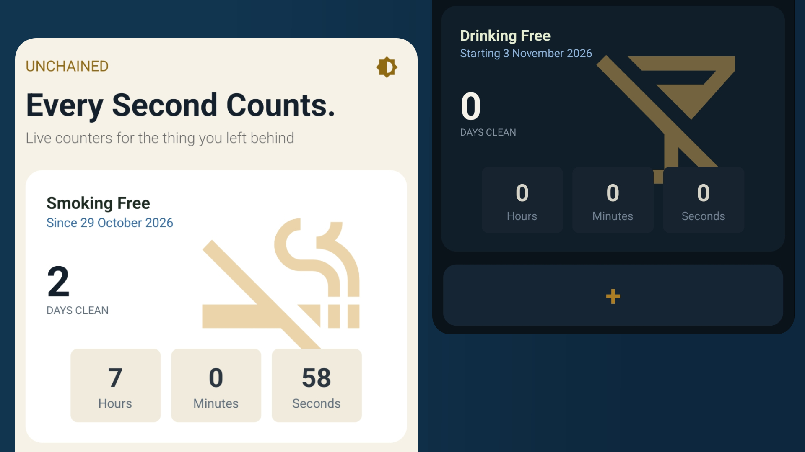

<p align="center">
  
</p>

# Unchained

**Every second counts.** Unchained is a private, offline streak counter for the habits you're leaving behind. Pick a habit, set the moment you stopped, and watch a live counter of days, hours, minutes and seconds tick up.

Built with React Native and Expo for Android.

<p align="center">
  <a href="https://github.com/grinarica/unchained/releases/latest"><b>Download the latest APK</b></a>
</p>

## Download

1. Open the [latest release](https://github.com/grinarica/unchained/releases/latest) and download the `.apk` file.
2. Open it on your Android phone. If asked, allow installs from your browser or file manager.
3. Requires Android 7.0 or newer.

This is a direct APK install, not a Play Store release.

## Features

- **Live counters** for smoking, drinking and porn, showing days, hours, minutes and seconds since your start moment
- **Future start dates**: schedule a start and the card reads "Starting" until it begins
- **Reset with confirmation** if you relapse, and **remove a card** you no longer want on the home screen
- **Custom wheel pickers** for date and time, built from scratch instead of the stock Android dialogs
- **Light, dark or system theme**, chosen from the home screen and remembered between launches
- **Private by design**: everything is stored in a local SQLite database on your phone. There are no accounts, no servers and no network requests.

## Tech stack

| | |
|---|---|
| Framework | [Expo](https://expo.dev) (SDK 58) with React Native |
| Navigation | Expo Router (file-based routing) |
| Language | TypeScript |
| Storage | `expo-sqlite` |
| Tooling | React Compiler, Bun |

## Run it locally

You need [Bun](https://bun.sh) (or Node.js) and an Android phone or emulator.

```bash
git clone https://github.com/grinarica/unchained.git
cd unchained
bun install
bun run start
```

Scan the QR code with Expo Go to run it on your phone.

> Expo Go always shows its own icon and splash screen. To see Unchained's real icon, name and splash, install a build (see below).

## Build an APK

**Cloud build with EAS** (no Android SDK needed):

```bash
bunx eas-cli login
bunx eas-cli build --platform android --profile preview
```

The `preview` profile produces an installable `.apk`. It needs this in `eas.json`:

```json
"preview": {
  "distribution": "internal",
  "android": { "buildType": "apk" }
}
```

**Local build** (needs JDK 17 and the Android SDK, with `ANDROID_HOME` set):

```bash
bunx expo prebuild --platform android
cd android
./gradlew assembleRelease
```

The APK is written to `android/app/build/outputs/apk/release/app-release.apk`.

## Project structure

```
src/
  app/           Screens and routes (home, habit/[type], add-habit)
  components/    HabitCard, ConfirmModal, theme and date/time pickers
  constants/     Habit definitions and colour themes
  hooks/         useElapsedTime, useThemeColors, useThemePreference
  libs/          SQLite database layer and theme storage
  utils/         Date and time helpers
assets/images/   App icon, adaptive icon and splash image
promo.jpg        Banner image used in this README
```

## Privacy

Your data never leaves your device. Habit start times are kept in a local SQLite database, and the theme choice in local key-value storage. Uninstalling the app deletes everything.

## License

Released under the MIT License. See [LICENSE](LICENSE).
